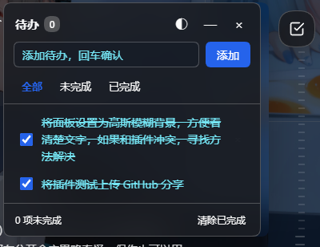

# 待办挂件 · dsh-todo-widget

DSH 界面右侧的悬浮待办面板。想记点什么随手点开，不用切到别的应用。



## 功能

- 悬浮按钮，可拖到任意位置，位置会被记住
- 角标显示未完成数量
- 回车添加，勾选完成，双击改名，拖动排序
- 全部 / 未完成 / 已完成 三种筛选，支持一键清除已完成
- 磨砂玻璃面板，强度 0–100% 可调，深色浅色主题自动适配
- 数据保存在本机，不联网、不上传

## 安装

从 GitHub 安装：

```powershell
dsh plugin --profile desktop add github:duoemma/dsh-todo-widget
```

安装后重启一次 DSH。

本地开发或离线安装：

```powershell
powershell -NoProfile -ExecutionPolicy Bypass -File install-plugin.ps1
```

卸载：

```powershell
powershell -NoProfile -ExecutionPolicy Bypass -File install-plugin.ps1 -Uninstall
```

## 使用

点右侧圆形按钮展开面板，`Esc` 关闭。右上角 `◐` 打开磨砂强度滑杆，拖动即时生效。

面板宽 332px，高不超过视口的 60%，列表区可滚动。浅色与深色主题使用不同的底衬色。

## 数据

| 位置 | 说明 |
|---|---|
| `~/.dsh/todo-widget/todos.json` | 主存储，由宿主端维护 |
| `localStorage["dsh-todo-widget:state"]` | 浏览器侧副本，宿主接口不可用时兜底 |

两份数据按写入时间取较新的一份；宿主接口不可用时自动退化为纯本地模式。

## 配置

| 项 | 说明 |
|---|---|
| 磨砂强度 | 面板内滑杆，0–100，默认 82 |
| `DSH_TODO_STORE_DIR` | 环境变量，指定存储目录（默认 `~/.dsh/todo-widget`） |

## 开发

```powershell
node build.mjs                 # 构建 client/standalone.js 与 client/client.js
node test\run-bundle-dom.cjs   # 用最小 DOM 桩跑一遍产物
node test-host.mjs             # 宿主端：路由、存储、版本号
node test-client.mjs           # 构建产物接缝检查
```

源码结构：

```
lib/index.js     宿主端，提供 /todo 下的 JSON 接口与页面注入
src/ui.js        面板渲染
src/runtime.js   悬浮按钮、拖拽、状态与持久化
src/entry.js     客户端入口
client/          构建产物，随包提交
```

改完 `src/` 后执行 `node build.mjs`。`client/` 需要一起提交——从 GitHub 安装时不会重新构建。挂件支持自更新：服务端构建号变化后，页面会在 45 秒内换成新版本。

## License

MIT
